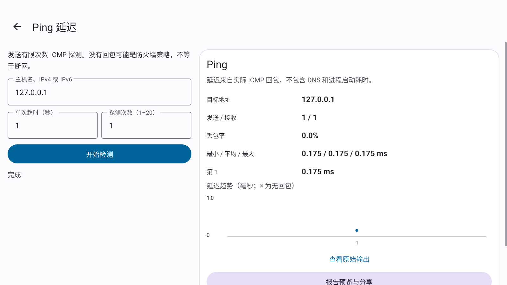
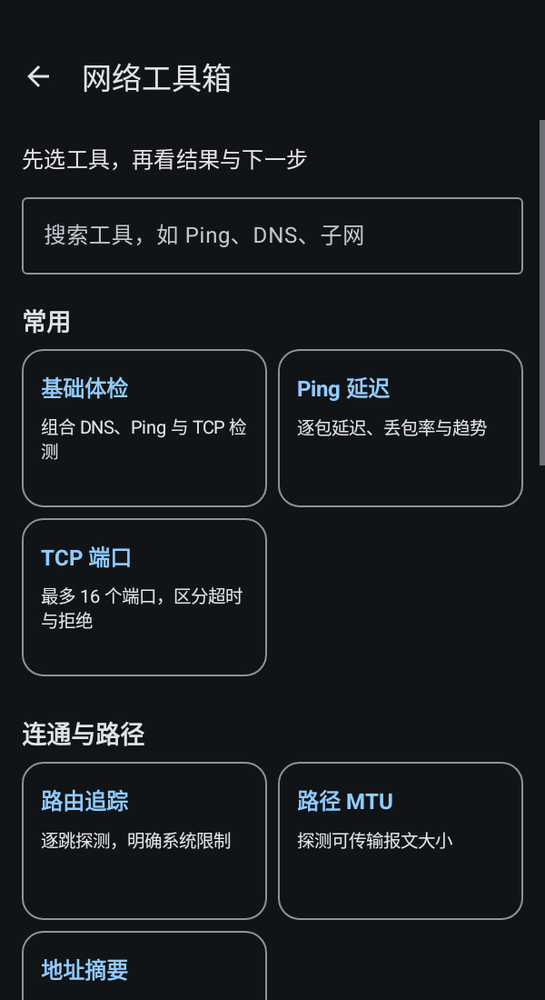

# NetSerial AI · V0.13.0 AI 自动任务

<p align="center">
  
</p>

<p align="center">
  <strong>手机和平板，就是你的随身网络运维工具箱。</strong><br>
  不懂命令，按问题排查；熟悉现场，直达专业工具。<br>
  免 Root 网络诊断 · USB Console · SSH/SFTP · AI 对话与受控自动任务
</p>

<p align="center">
  <a href="https://github.com/chenwei666/NetSerial-AI/releases/latest"><strong>下载最新正式版</strong></a>
  · <a href="#三步开始">快速上手</a>
  · <a href="README_EN.md">English</a>
  · <a href="https://github.com/chenwei666/NetSerial-AI/issues">反馈问题 / 提建议</a>
</p>

<p align="center">
  <a href="https://github.com/chenwei666/NetSerial-AI/releases/latest"></a>
  
  
  <a href="LICENSE"></a>
</p>

**NetSerial AI 是一个开源 Android 网络运维工具箱。** 从“上不了网”“交换机登不上”“端口不通”出发，收集证据、读懂结果，再决定下一步；也可以直接打开 Ping、DNS、TCP、TLS 等工具做专业检查。

V0.13.0 在 **16 项免 Root 工具箱**和确认式 AI 记忆基础上增加显式自动任务：从当前设备终端进入，用一句话描述目标，由 AI 读取现状、追问必要信息并逐步执行；高风险操作仍由你确认。

> **V0.13.0 正式版已发布，GitHub Latest 已指向本版。** [下载正式 APK](https://github.com/chenwei666/NetSerial-AI/releases/download/v0.13.0/NetSerial-AI-0.13.0.apk) · [发布说明](https://github.com/chenwei666/NetSerial-AI/releases/tag/v0.13.0) · [校验文件](https://github.com/chenwei666/NetSerial-AI/releases/download/v0.13.0/SHA256SUMS.txt)。[PR #18](https://github.com/chenwei666/NetSerial-AI/pull/18) 已合并，标签与合并提交一致；Release 非草稿、非预发布，线上 APK 与校验文件重新下载核验通过。[V0.12.0](https://github.com/chenwei666/NetSerial-AI/releases/tag/v0.12.0) 保留为历史正式版。

> **普通聊天仍然只生成草稿；自动任务需要你显式开始。** 任务绑定当前连接，不选择“最近设备”。精确白名单查询与目标范围内有限 VLAN/描述配置可以自动执行；高风险或未知风险要求输入完整目标名称确认，受保护设备继续校验变更任务与维护窗口。

## AI 自动任务：从当前设备开始

- 先连接 USB Console / SSH / Telnet、完成登录并停在正常 CLI 提示符，再从该终端进入 AI → **AI 自动执行**。只使用当前选定的厂商和模型，不静默切换服务商。
- 单动作严格 JSON、本地风险门禁、设备识别、现状读取与回读检查；不是任意命令自由执行。每次最多 32 步/10 分钟，缺参数时追问；出错、分页/交互、超时、断线、取消或离页停止，无自动重试/恢复。
- 显示本次执行回执，已发送的配置可能已生效；不会自动保存启动配置或回退。查询不等于完整业务验收，模型总结不是成功证据。
- 任务页可控制是否使用已确认记忆并进入记忆管理，沿用普通聊天偏好，每次最多 5 条；不自动写新记忆，也不把记忆当执行授权。
- **开通 Web 与账号：** WEB_ACCESS 使用本地 H3C Comware 5/7、Huawei VRP、Cisco IOS/IOS XE、Ruijie RGOS 模板；密码只填专用本地安全框，不进入模型/聊天/记忆。模板整体一次高风险确认，提示创建/覆盖账号、权限和 HTTP 风险。敏感回显隐藏至重新连接，不证明网页可达或登录成功。口令数组会清零，但不承诺清除全部 JVM String / 系统副本。

## 遇到问题，直接找到工具

| 你想解决的问题 | 可以打开 |
|---|---|
| 上不了网，不知道从哪查 | 基础体检：组合单目标 DNS、Ping、TCP，查看证据与下一步 |
| 网络慢、偶尔掉线 | Ping：逐包 RTT、发送/接收、丢包率、最小/平均/最大值与趋势 |
| 交换机、服务端口连不上 | TCP 检测：指定端口，区分拒绝、超时和连接成功 |
| 域名或网站打不开 | DNS 查询、HTTP/HTTPS 响应头检查、TLS 证书检查 |
| 想知道路径或报文大小问题 | 免 Root 路由追踪、IPv4 DF/MTU 探测，明确未知或受限结果 |
| 看本机网络、找授权私网内的设备 | 当前网络信息、地址摘要、受限局域网发现 |
| 远程设备支持网络唤醒 | Wake-on-LAN：确认目标与 MAC 后发送唤醒报文 |
| 要算网段、查 MAC 或常用端口 | IPv4/IPv6 CIDR、MAC/OUI、端口速查、网络标识提取 |
| 不懂交换机输出、记不住命令 | 新手向导、多厂商只读命令、报告预览与 AI 对话 |

## 手机和平板，都有合适的布局

### 平板 · 浅色



### 手机窄屏 · 深色



以上为 **V0.12.0 工具箱基线截图**，来自 Android API 34 实际应用，不是 V0.13.0 自动任务页面的验收截图，也不代表所有实体手机、平板或交换机兼容。支持中英文、跟随系统 / 浅色 / 深色及既有四套主题。

- 工具搜索与用途分类，选中后只显示相关参数，不再堆满按钮。
- 数值、结果明细与进度优先；原始输出折叠保留，便于专业排查。
- 支持停止任务；失败、部分完成、不支持、取消分别解释，不把错误文字当成检测成功。
- 报告先脱敏预览，再复制、分享或带入 AI 草稿；不会自动发送给 AI。

## AI：读得清楚，也记得有分寸

标题、粗体、列表、引用、行内代码和代码块原生排版，不再满屏显示 `**`。命令中的真实星号与换行仍保留，支持单独复制代码、复制原文和人工审核命令。

**确认后记住：** 点击“记住这条” → 编辑内容 → 选择个人偏好或已命名设备档案 → 确认保存。记忆可查看、编辑、删除、关闭使用，与聊天历史分开；删除聊天不会误删记忆，也不会把每次问答自动存为长期记忆。

- Android 6.0+ 加密保存，180 天到期，每次最多选用 5 条适用记忆，可查看最近请求选用了哪些条目。
- 设备范围按档案名称区分，不是验证后的硬件身份；旧自动记忆不自动导入。
- 多轮会话、停止/重试、历史管理和既有命令风险门禁继续保留。

内置 **18 类 AI 接入入口**：OpenAI、Anthropic、Gemini、DeepSeek、智谱 GLM、通义千问、豆包、腾讯混元 / TokenHub、百度千帆、Kimi、MiniMax、硅基流动、Groq、Mistral、xAI、OpenRouter、自定义兼容接口和 HTTPS Ollama。使用自己的 API Key，按接入能力同步上游模型，支持缓存、筛选和手动填写。

自定义入口面向 **OpenAI-compatible** 接口，不等于任何厂商的任意协议均可直连。在线 AI 会收到你确认发送的上下文与启用的记忆，费用及数据规则以服务商为准。**不要发送密码、私钥或未经检查的敏感配置。** 本地删除不能撤回服务商已接收的内容。

## 工程师常用能力，继续保留

| 能力 | 现场用途 |
|---|---|
| USB Console | OTG 串口、波特率、流控、控制线、HEX 与后台接收 |
| SSH / SFTP | 远程终端、跳板机、Keepalive、文件传输、主机密钥变更阻断 |
| 受控 Telnet | 兼容旧设备，默认关闭，每次连接提示明文风险 |
| 命令辅助 | 真实 Tab、问号、Ctrl+C、方向键；H3C / Huawei / Cisco / Ruijie 分类命令 |
| 配置与变更 | 脱敏快照、Diff、回滚草稿、目标校验、维护窗口与变更证据 |
| 运维中心 | 故障取证计划、运行手册、安全巡检、拓扑回显解析与厂商识别 |
| 新手排障 | 十个问题场景，当前终端已有回显读取、解释与继续排障 |

Tab 补全依赖设备终端本身。厂商命令与识别规则不表示全部型号或固件已实测。运维中心的“读取当前设备”入口只利用已有终端输出；新增 AI 自动任务则按上文授权规则主动下发。缺页/截断配置不是完整恢复备份。

## 检测有边界，结果不夸大

- **不需要 Root，也不绕过系统权限。** Trace 依赖系统 TTL 探测能力及路由器回包，未知跳保持未知；IPv4 DF/MTU 超时不被当作准确上限，1500 字节成功仅证明该大小可通过。
- **主动发现需要确认。** 仅 RFC1918 私网 `/26`–`/32`、最多 64 个地址和 4 个指定 TCP 端口、40 秒预算。未响应不等于离线，不是完整资产扫描。WOL 已发送不等于设备已开机。
- **协议检查保持安全。** DNS 使用系统或明确指定服务器，不暗中切换公共 DNS，不验证 DNSSEC。HTTP 仅 HEAD、不跟随跳转、不下载正文、不发送账号或 Cookie；TLS 不忽略证书/域名错误，不做完整协议或吊销扫描。
- **不是一键修复或带宽测速。** 检查从手机/平板发起；Ping 不通不证明离线，TCP 成功不证明账号可登录。OUI 内置数据有限，未知厂商不猜测。

## 三步开始

1. **安装并核对版本**：下载 [V0.13.0 正式 APK](https://github.com/chenwei666/NetSerial-AI/releases/download/v0.13.0/NetSerial-AI-0.13.0.apk)，并核对 [SHA256SUMS.txt](https://github.com/chenwei666/NetSerial-AI/releases/download/v0.13.0/SHA256SUMS.txt)。沿用原生产证书，已验证 V0.12.0 覆盖升级；先备份重要信息，不要先卸载。独立 Preview 不是正式版覆盖升级包。
2. **选问题或工具**：新手从首页场景开始，熟悉操作可直达工具箱搜索。只有获授权的目标才应被检测；私网发现与 WOL 需核对后确认。
3. **选择聊天或自动任务**：配置 AI 后可手动发送普通问题；需要执行任务时，从已连接设备终端显式进入自动任务，明确目标并开始。高风险确认前核对设备和影响。

最低 Android 5.0；加密凭据、持久化聊天/记忆及当前默认网络详情需要 Android 6.0+。新增普通 `ACCESS_NETWORK_STATE` 权限用于读取当前网络/DNS；不申请 Root、定位或 VPN 抓包权限。

## 验证与文档

V0.13.0 本地正式构建通过 **435 项测试，Release Lint 0 错误 / 222 警告**。正式 APK 的 V1/V2/V3 签名通过，生产应用身份保持不变，证书与 GitHub V0.12.0 正式包一致。API 34 环境完成正式 V0.12.0 code 14 → V0.13.0 code 15 覆盖安装，首次安装时间保持，冷启动 Status 为 ok。详见 [本版测试报告](Version/V0.13.0/docs/TEST_REPORT.md)。

最终源码对应的独立预览包已重新安装，并再次通过手机/平板 × 中英文 × 深浅色 **8 组 UI 测试，每组 42 项断言**。模拟器恢复连接后完成了收紧中文任务范围校验后的复测；这些是预览包 UI 证据，不等同真实设备或服务商端到端验证。

正式 APK：**6,560,459 bytes**；SHA-256：`c1fadf90e9a2045eedb2aca715f6b2bd32a69e65f6433bd1807a80dc32ffb85d`。GitHub APK 与校验文件已重新下载，大小/哈希与本地产物一致，下载实物的 V1/V2/V3 签名再次核验通过。标签 `v0.13.0` 指向 PR #18 合并提交 `eff52f6d8960ebf5847f32cac0eedf34a3e3515e`；Latest API 已确认本版，draft/prerelease 均为 false。

尚未完成真实 AI 服务商、实体手机/OEM、物理交换机及真实用户数据迁移验收。自动执行与 Web 模板必须在获授权环境核对兼容性，不能仅凭编译、模拟回显或 UI 测试声称所有设备可用。历史版结果保留在 [版本历史](VERSION_HISTORY.md)。

- [中文使用说明](Version/V0.13.0/README.md) · [English guide](Version/V0.13.0/README_EN.md)
- [安全边界](Version/V0.13.0/docs/SECURITY.md) · [安全问题报告](SECURITY.md)
- [构建与签名](Version/V0.13.0/docs/RELEASE.md) · [架构](Version/V0.13.0/docs/ARCHITECTURE.md)
- [变更记录](CHANGELOG.md) · [历史版本](VERSION_HISTORY.md) · [贡献指南](CONTRIBUTING.md)

从源码构建独立预览：

```powershell
powershell.exe -NoProfile -ExecutionPolicy Bypass -File .\Version\V0.13.0\scripts\build.ps1
```

Debug 包名 `com.chenwei666.netserial.preview013`，与正式版共存，不自动导入其凭据和历史。完整历史源码保存在 `Version/V*`；V0.11.0 是并入 V0.12.0 的开发记录，不单独发布 Release。生产签名材料不进入仓库。

## 一起把现场经验变成好用的工具

最欢迎三类反馈：**“什么设备遇到什么问题”**、**“这条命令在我的固件不适用”**、**“这个结果我看不懂”**。提交 [Issue](https://github.com/chenwei666/NetSerial-AI/issues) 时附机型、Android 版本、设备厂商/固件与脱敏复现步骤，不附带密码或 API Key。

欢迎贡献命令、中英文说明、真实设备验证或小而可复现的 PR。如果它在现场帮到了你，欢迎点一个 **Star**，方便以后找到，也让更多同行发现它。

## 来源与许可证

基于 Kai Morich 的 [SimpleUsbTerminal](https://github.com/kai-morich/SimpleUsbTerminal) 扩展，保留 MIT 许可证与上游署名。新增功能与维护者：[chenwei666](https://github.com/chenwei666)。详见 [LICENSE](LICENSE) 与 [UPSTREAM.md](Version/V0.13.0/UPSTREAM.md)。
