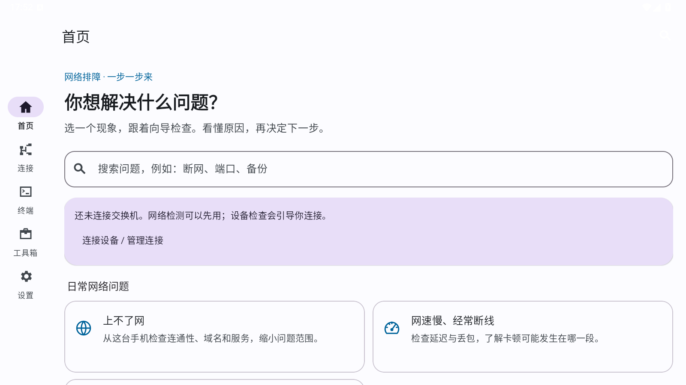
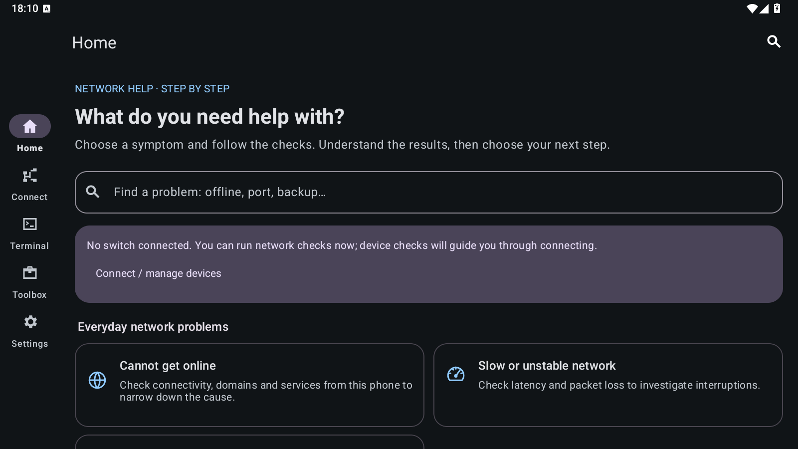

# NetSerial AI

<p align="center">
  
</p>

<p align="center">
  <strong>Start with the network problem, not a command to memorize.</strong><br>
  Guided troubleshooting for beginners. A field toolkit for network engineers.<br>
  Android · USB Console · SSH/SFTP · Network diagnostics · Switch commands · AI
</p>

<p align="center">
  <a href="https://github.com/chenwei666/NetSerial-AI/releases/tag/v0.10.0"><strong>Download V0.10.0</strong></a>
  · <a href="#get-started-in-three-steps">Quick start</a>
  · <a href="README.md">简体中文</a>
  · <a href="https://github.com/chenwei666/NetSerial-AI/issues">Report a problem / Suggest a feature</a>
</p>

<p align="center">
  <a href="https://github.com/chenwei666/NetSerial-AI/releases/latest"></a>
  
  
  <a href="LICENSE"></a>
</p>

**NetSerial AI is an open-source Android toolkit for network troubleshooting.** Choose a symptom—no internet, an unreachable switch, or a port that is down—and follow a path to collect evidence, understand the results, and decide what to check next.

Already comfortable with a terminal? USB serial, SSH, SFTP, real Tab input, multi-vendor commands, and configuration comparisons are still available. Need another perspective? Review a troubleshooting report and take it to an AI provider you configure yourself.

> **AI does not operate your switch for you.** AI replies and guided commands are reviewable drafts, not automatic actions. You remain responsible for the target, command, risk, and final send.

## Start with what is going wrong

| Your problem | How the toolkit helps |
|---|---|
| No internet access | Run bounded DNS, Ping, and TCP checks against one target and get explanations and next steps |
| Slow or intermittent network | Observe short-term reachability and latency, with clear limits on what the results prove |
| A domain will not open | Check name resolution and use connectivity evidence to narrow the investigation |
| Cannot log into a switch | Check a specified management port, then review protocol, address, and authentication |
| A switch port is down | Prepare vendor-specific read-only checks and interpret pasted or captured port output |
| VLAN or gateway trouble | Work through VLAN, interface, and Layer 3 evidence with suggested checks |
| Unknown switch vendor | Read existing terminal output and identify H3C, Huawei, Cisco, or Ruijie fingerprints |
| Need a switch health check | Follow read-only checks and inspect health indicators in the output |
| Need a configuration record | Collect and inspect output, then explicitly save and compare it in the snapshot center |
| Unclear output or unfamiliar commands | Preview the report, open a fresh AI draft, and choose whether to send it |

**Know the limits:** checks originate from the phone, not a PC's network adapter, and are not bandwidth tests. No Ping reply does not prove a device is offline; an open TCP port does not prove login works. Device capture reads existing session output without silently sending new commands. Truncated or paginated configuration output is not a complete recovery backup.

## See the interface

### Chinese · Light



### English · Dark



These are **real preview-app screenshots from an Android API 34 test environment at 1600×900**, not mockups or evidence of physical-device or switch compatibility. The app supports Chinese and English, system/light/dark appearance, and four accent themes.

## V0.10.0: choose a problem, follow the evidence

- **Ten starting points and symptom search:** find a workflow without knowing the name of the tool first.
- **Explanations next to results:** see what was tested, what remains uncertain, and what to check next.
- **Return to the terminal, then resume:** retain this session's inputs while moving between connections and guides. Drafts live in the current process, not guaranteed across app restarts.
- **Preview before sharing or asking AI:** inspect a report before sharing it or opening a fresh AI draft. Sending to AI is never automatic.
- **Professional tools remain:** grouped tools preserve direct access to terminals, commands, diagnostics, and the operations center. Favorites and recents are collapsed by default.

See the [changelog](CHANGELOG.md), [version history](VERSION_HISTORY_EN.md), and [V0.10.0 guide](Version/V0.10.0/README_EN.md).

## A toolkit for experienced engineers, too

| Capability | Field use |
|---|---|
| USB Console | OTG serial, baud rate, flow control, control lines, HEX, and background receive |
| SSH / SFTP | Remote terminal, jump hosts, keepalive, file transfer, and changed-host-key blocking |
| Controlled Telnet | Legacy compatibility; disabled by default with a plaintext warning before each connection |
| Command assistance | Real Tab, `?`, Ctrl+C, and arrow keys; categorized H3C / Huawei / Cisco / Ruijie commands |
| AI chat and memory | Multi-turn conversations, stop/retry, device memory, command explanation and review |
| Network tools | DNS, Ping, Traceroute, bounded TCP checks, MTU, IPv4/IPv6 CIDR, and MAC/OUI |
| Configuration and changes | Redacted snapshots, configuration Diff, rollback drafts, target checks, risk gates, and change evidence |
| Operations center | Incident evidence plans, runbooks, security checks, topology-output parsing, and vendor detection |

Command and detection rules cover common vendor platforms; **they are not a claim that every model or firmware version has been tested**. Actual Tab completion depends on the connected device's terminal.

## Your AI provider, your decision to send

There are **18 provider entry types**: OpenAI, Anthropic, Gemini, DeepSeek, Zhipu GLM, Qwen, Doubao, Tencent Hunyuan / TokenHub, Baidu Qianfan, Kimi, MiniMax, SiliconFlow, Groq, Mistral, xAI, OpenRouter, a custom compatible endpoint, and HTTPS Ollama.

- Bring your own API key. Supported integrations can load upstream model catalogs, with caching, filtering, and manual model-name fallback.
- Custom endpoints target **OpenAI-compatible** APIs, not every provider's arbitrary protocol. Model catalogs and availability depend on the provider and account permissions.
- Local diagnostics, offline commands, and terminal use do not require an AI account. When you confirm an online AI request, its content goes to your selected provider; that provider's pricing and data-handling terms apply.
- Secure credential storage and persisted AI history require Android 6.0+ and use Android Keystore-backed encryption. Redaction is best-effort: inspect internal addresses, device names, and business-sensitive content before sending or sharing.

**Do not upload passwords, private keys, or unreviewed sensitive configurations. AI can suggest unsuitable commands; verify them against the device, firmware, and your authorization.**

## Get started in three steps

1. **Install:** open the [V0.10.0 release](https://github.com/chenwei666/NetSerial-AI/releases/tag/v0.10.0), download the production APK from Assets, and compare it with `SHA256SUMS.txt` on the same page. Minimum installation is Android 5.0; Android 6.0+ is recommended for encrypted credential features.
2. **Choose the problem:** select a home-screen scenario and enter a target. For switch troubleshooting, connect through USB OTG or SSH first, then review and manually run the guide's read-only commands.
3. **Read the results and continue:** return to the guide to capture output and inspect the explanation. Configure AI only if needed, preview the report, and decide whether to send it.

Only test targets you own or are authorized to manage. Before production changes, check the device, permissions, maintenance window, and rollback plan.

## FAQ

**Can I use it without knowing switch commands?**

Start with guided scenarios and phone-side checks, then follow the explanations. The app helps narrow a problem; it does not promise to fix every network with one tap.

**Does it work without AI?**

Yes. Terminals, offline commands, local checks, and local output explanations do not depend on AI. AI is optional.

**Does connecting automatically retrieve the full configuration?**

No. Device capture reads existing terminal output. Review and run read-only commands manually when more information is needed, then check pagination, truncation, and completeness before saving.

**Why do advanced operations still require confirmation?**

The wrong command or target can disrupt production. The AI page blocks R4 commands, and other loadable commands still require human review; terminals also apply local risk gates. Guided mode does not disable these protections.

**Has every device and provider been tested?**

No. This version has 246 passing unit tests, resource checks, and production APK signature/alignment checks; Release Lint reports 0 errors and 158 warnings. API 34 checks cover the guided flows and a cold-start home screen after upgrading the V0.9.1 production app to V0.10.0. Physical phones, USB chipsets, real switches, and owned AI accounts still need field validation. Read the [validation record and uncovered scope](Version/V0.10.0/docs/BEGINNER_VALIDATION.md).

## Documentation and source

- [English guide](Version/V0.10.0/README_EN.md) · [中文使用说明](Version/V0.10.0/README.md)
- [Security boundaries](Version/V0.10.0/docs/SECURITY.md) · [Report a security issue](SECURITY.md)
- [Build and signing](Version/V0.10.0/docs/RELEASE.md) · [Architecture](Version/V0.10.0/docs/ARCHITECTURE.md)
- [Roadmap](ROADMAP.md) · [Contributing](CONTRIBUTING.md) · [Version history](VERSION_HISTORY_EN.md)

Build a preview from source:

```powershell
powershell.exe -NoProfile -ExecutionPolicy Bypass -File .\Version\V0.10.0\scripts\build.ps1
```

Complete version sources remain under `Version/V*`. Production signing material is never included. Preview builds use a separate application ID and do not automatically migrate production-app data.

## Help turn field experience into better tools

Useful feedback starts with **“this device had this problem,” “this command does not work on my firmware,”** or **“I could not understand this result.”** Open an [issue](https://github.com/chenwei666/NetSerial-AI/issues) with your phone model, Android version, switch vendor/firmware, and redacted reproduction steps. Never include passwords or API keys.

Contributions of commands, bilingual documentation, real-device test results, and small, verifiable pull requests are welcome. If the toolkit helps you in the field, consider giving it a **Star** so you can find it again and other engineers can discover it.

## Origin and license

Built on Kai Morich's [SimpleUsbTerminal](https://github.com/kai-morich/SimpleUsbTerminal), retaining the upstream MIT license and attribution. New features and maintenance: [chenwei666](https://github.com/chenwei666). See [LICENSE](LICENSE) and [UPSTREAM.md](Version/V0.10.0/UPSTREAM.md).
